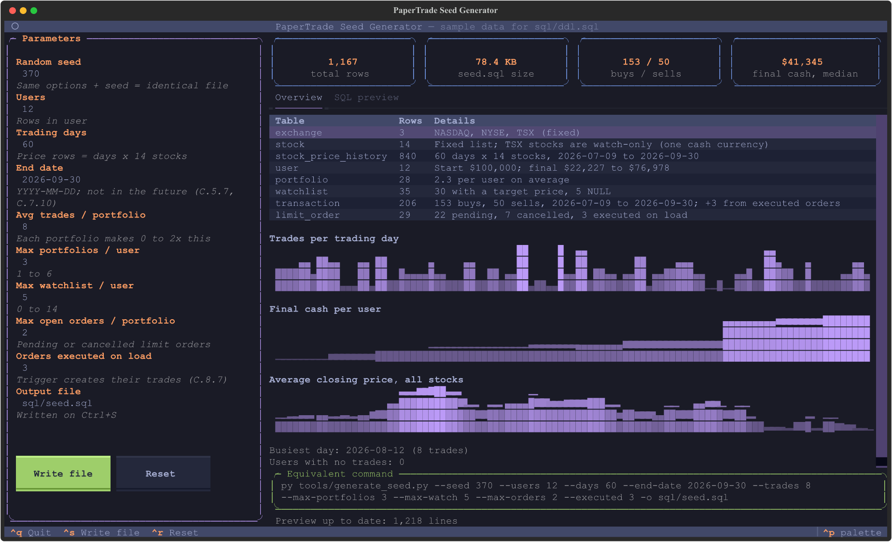

# PaperTrade

## Description

PaperTrade is a paper-trading (simulated, fake-money) stock trading app, built as the semester project for CSC 370 (Database Systems) at UVic. The course grades the database design, so this repo is mostly SQL and design documents. All data in it is fictional.

Users sign up with $100,000 of paper cash, open portfolios (TFSA, RRSP, ...), and buy and sell stocks listed on NASDAQ, NYSE and TSX at historical daily prices. They can watch stocks with a price alert and place limit orders that execute later.

The MySQL 8.0 schema (`sql/ddl.sql`) has 8 tables:

| Table | Holds |
|-------|-------|
| `user` | Accounts and uninvested cash |
| `portfolio` | Trading accounts owned by a user |
| `exchange` | Stock exchanges (lookup) |
| `stock` | Listed equities |
| `stock_price_history` | Daily open / close / high / low / volume (weak entity of `stock`) |
| `watchlist` | Stocks a user watches, with an optional target price (M : N) |
| `transaction` | Immutable ledger of executed trades |
| `limit_order` | Pending, executed and cancelled orders |

Besides keys, foreign keys and `CHECK`s, the database enforces the trading rules with triggers. A buy can't cost more than the user's cash, a sell can't exceed the shares held, trades update the cash balance and can't be edited or deleted, and executing a limit order records the matching trade. Every rule has an ID (C.x.y) used across the SQL and the documents.

## Important documents

| Document | What it covers | Status |
|----------|----------------|--------|
| [Schemata Overview](docs/Schemata%20Overview/schemata.md) | Every table's attributes, keys, constraints and relationships; the reference for the C.x.y IDs | Current |
| [ERD](docs/ERD/papertrade_erd.pdf) | Entity-relationship diagram | Current |
| [Relational Algebra Constraints](docs/Relational%20Algebra%20Constraints/ra-constraints.pdf) | Goal C: each constraint as a subset or empty-set expression, with a linked glossary | Current |
| [Candidate Keys](docs/Candidate%20Keys/candidate-keys.pdf) | Goal A: functional dependencies, closures, candidate keys and superkeys per table; BCNF | Current |
| [Minimal Basis and FD Projection](docs/Minimal%20Basis%20and%20FD%20Projection/fd-projection.pdf) | Goal B: minimal basis, FD projection, dependency preservation | Old 4-table schema |
| [Lossless Join Proof](docs/Lossless%20Join%20Proof/losslessjoin.pdf) | Goal B: decomposition of the universal relation and the chase test | Old 4-table schema |
| [Seed generator guide](tools/README.md) | How to generate `sql/seed.sql` | Current |
| [Sprint reports](sprints/) | Sprint planning and reports | |
| [AI use](AI_USE.md) | Where generative AI was used and how we checked it | |

Each document in `docs/` has its LaTeX source (`.tex`) next to the PDF.

## Usage

### Files

| Path | What it is |
|------|------------|
| `sql/ddl.sql` | Creates the `stock_trading` database: tables, constraints and triggers |
| `sql/seed.sql` | Sample data, generated by `tools/generate_seed.py` |
| `sql/queries.sql` | Goal D queries (cleared while they're rewritten for the 8-table schema) |
| `sql/constraint_tests.sql` | Tests for every constraint (C.x.y): invalid values that must be rejected, boundary values that must be accepted, defaults and trigger effects |
| `tools/generate_seed.py` | Seed data generator: CLI, plus an interactive TUI with `--tui` |
| `docker-compose.yml` | MySQL 8.0 with `ddl.sql` and `seed.sql` loaded |
| `.github/workflows/main.yml` | CI: loads `ddl.sql` and `seed.sql` on MySQL 8.0, then runs the constraint tests and queries |

### 1. Start the database

You need MySQL 8.0. `sql/ddl.sql` starts with `DROP DATABASE IF EXISTS stock_trading;`, so don't run it against a server whose `stock_trading` database you want to keep.

**Option A: Docker (all platforms; use this on Windows).** Needs [Docker Desktop](https://www.docker.com/products/docker-desktop/) running. Run these from the repo root in PowerShell, Command Prompt or a macOS/Linux shell. On Windows, don't use Git Bash, which rewrites the `/sql` paths.

```
docker compose up -d --wait
```

This creates the schema and loads the seed data (`ddl.sql`, then `seed.sql`), and returns once the database is ready (20–60 seconds; the first run also downloads the image).

**Option B: a local MySQL 8.0 server.**

```bash
mysql -u root -p < sql/ddl.sql
mysql -u root -p < sql/seed.sql
```

### 2. Check the data

```
docker compose exec db mysql -uroot -prootpassword -t stock_trading -e "SELECT 'exchange' t, COUNT(*) n FROM exchange UNION ALL SELECT 'stock', COUNT(*) FROM stock UNION ALL SELECT 'stock_price_history', COUNT(*) FROM stock_price_history UNION ALL SELECT 'user', COUNT(*) FROM user UNION ALL SELECT 'portfolio', COUNT(*) FROM portfolio UNION ALL SELECT 'watchlist', COUNT(*) FROM watchlist UNION ALL SELECT 'transaction', COUNT(*) FROM transaction UNION ALL SELECT 'limit_order', COUNT(*) FROM limit_order"
```

With the default seed, expect: `exchange` 3, `stock` 14, `stock_price_history` 840, `user` 12, `portfolio` 28, `watchlist` 35, `transaction` 206 (203 inserted, plus 3 created by executed limit orders), `limit_order` 29. The counts for any other seed are in the header of `sql/seed.sql`. For a local server, run the same `SELECT` in `mysql -u root -p stock_trading`.

Docker commands that pass a password print `Using a password on the command line interface can be insecure`, which is expected.

### 3. Run the queries and constraint tests

```
docker compose exec db sh -c "mysql -uroot -prootpassword -t stock_trading < /sql/queries.sql"
docker compose exec db sh -c "mysql -uroot -prootpassword -t stock_trading < /sql/constraint_tests.sql"
```

Locally: `mysql -u root -p -t stock_trading < sql/queries.sql`, and the same for `constraint_tests.sql`. `queries.sql` is currently empty.

The constraint tests create their own test rows, so they work with any seed. A rejection test passes only if MySQL rejects its statement with the expected error code. The other tests check that boundary values are accepted (e.g. spending exactly all your cash) and that defaults and triggers had the right effect. Expect `95 | 95` passed. Everything runs in a transaction that is rolled back, so the data is unchanged (the last test checks this). If any test fails, the file ends with `ERROR 1644 ... Constraint tests failed`.

### 4. Generate seed data

`sql/seed.sql` is generated, not hand-written. Regenerate it with Python 3.9+ (`py` on Windows, `python3` elsewhere):

```
py tools/generate_seed.py                                  # defaults -> sql/seed.sql
py tools/generate_seed.py --users 50 --days 120 --seed 7   # a larger data set
py tools/generate_seed.py -h                               # all options
```

The same options always give the same file. The generator replays every trade against the user's cash and the portfolio's holdings, so the data always passes the triggers.

For an interactive editor with a live preview of the SQL, install Textual once and add `--tui`:

```
py -m pip install -r tools/requirements.txt
py tools/generate_seed.py --tui
```



Options are on the left. On the right are row counts per table, activity charts, a syntax-highlighted SQL preview and the equivalent CLI command. Press Ctrl+S to write the file. See the [seed generator guide](tools/README.md) for every option.

### 5. Reload after changes

`ddl.sql` and `seed.sql` only load when the Docker database is first created. After editing either one (or regenerating the seed), reset and start again:

```
docker compose down -v
docker compose up -d --wait
```

Edits to `queries.sql` or `constraint_tests.sql` need no reset. If startup fails (e.g. `container papertrade-db exited`), an SQL file has an error: `docker compose logs db` shows it. `docker compose down -v` also deletes the container and its data when you're done.

### 6. Build the documents

The PDFs are committed, so this is only needed after editing a `.tex` file. With a TeX distribution (e.g. TeX Live), from that document's folder:

```
latexmk -pdf ra-constraints.tex
```

## AI use

See [AI_USE.md](AI_USE.md).
